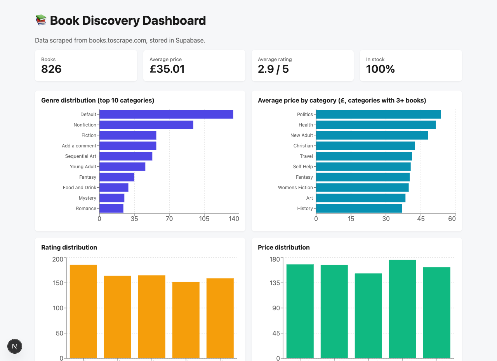

# Books to Scrape: scraper, database and dashboard

A Python web scraper that collects the full catalogue of [books.toscrape.com](https://books.toscrape.com/) (a sandbox site built for scraping practice), stores the structured data in a **Supabase (PostgreSQL)** table, and uploads the cover images to **Supabase Storage**. The data is then queryable through Supabase's auto-generated REST API.



## Purpose

The project turns a website that only humans can browse into a dataset that can be queried and analysed. It has three parts:

1. **Scraper** (`scraper.py`) collects every book from books.toscrape.com.
2. **Database** (Supabase Postgres and Storage) keeps the books and their cover images.
3. **Interface**: a Next.js dashboard (`dashboard/`) with summary statistics and charts, plus the REST API that Supabase generates automatically.

## Data collection

books.toscrape.com is a public sandbox shop built for scraping practice, so scraping it is allowed and there is no API. The scraper requests the HTML pages with `requests` and parses them with BeautifulSoup:


```
books.toscrape.com ──requests + BeautifulSoup──> scraper.py ──supabase-py──> Postgres table `books`
                                                                       └────> Storage bucket `book-covers`
```

1. **Crawl** – `iter_product_urls()` walks the paginated catalogue (`catalogue/page-1.html` onward, following the "next" link) and yields every book's detail-page URL.
2. **Parse** – `parse_book()` extracts, per book: UPC, title, category (from the breadcrumb), price in GBP, star rating (0–5, mapped from CSS class), stock status and count, description, product URL and image URL.
3. **Upload image** – the cover is downloaded and stored in the public `book-covers` bucket as `<upc>.jpg`; its public URL is saved with the record.
4. **Upsert** – the record is written to `books` with `on_conflict="upc"`, so re-running the scraper updates existing rows instead of creating duplicates (idempotent).

Robustness: requests retry 3× with exponential backoff, a 0.2 s delay between requests keeps the load on the server low, and a failure on one book is logged and skipped rather than aborting the run.

## Data persistence

| What | Where | Why |
| --- | --- | --- |
| One row per book (see the data model below) | Supabase Postgres, table `public.books` | A relational table with constraints (`upc` primary key, rating `CHECK`) keeps the data clean, and Supabase gives a REST API and a hosted database for free |
| Cover images | Supabase Storage, public bucket `book-covers`, stored as `<upc>.jpg` | Images don't belong in table rows. A public bucket gives each cover a stable URL, which is saved in `image_public_url` |
| Credentials | Local `.env` / `dashboard/.env.local` (git-ignored) | Keys must never be committed. `.env.example` and `dashboard/.env.local.example` show the required variables |

Re-running the scraper **upserts** on `upc`, so it updates existing rows instead of duplicating them. Row Level Security allows anyone to read, but only the `service_role` key (used by the scraper) can write.

## Project structure

| File | Purpose |
|---|---|
| `scraper.py` | Crawler, parser, and Supabase writer (CLI) |
| `schema.sql` | Table definition and storage bucket, run once in Supabase |
| `requirements.txt` | Python dependencies |
| `supabase/config.toml` | Supabase CLI project config (for optional local development) |
| `.env.example` | Template for the scraper's `.env` (the real `.env` is not committed) |
| `dashboard/` | Next.js + Recharts dashboard (the user interface) |
| `docs/` | Screenshot |

## Setup

**Requirements:** Python 3.9+ and a free [Supabase](https://supabase.com) project.

```bash
# 1. Install dependencies
python3 -m venv .venv
source .venv/bin/activate
pip install -r requirements.txt

# 2. Create the table and bucket:
#    paste schema.sql into Supabase Dashboard -> SQL Editor -> Run

# 3. Configure credentials (Project Settings -> API in Supabase)
cp .env.example .env               # then fill in SUPABASE_URL and SUPABASE_SERVICE_KEY
# The service_role key can write to everything: keep it server-side and never commit it.
```

## User interaction

There are three ways to use the data: run the scraper from the command line, browse the dashboard, or query the REST API.

### Scraper (CLI)

```bash
python scraper.py                  # scrape all ~1000 books + images
python scraper.py --limit 10       # only the first 10 books (quick test)
python scraper.py --no-images      # skip image upload
python scraper.py --dry-run        # scrape and log only, write nothing to Supabase
```

## Data model (`public.books`)

| Column | Type | Notes |
|---|---|---|
| `upc` | text | **Primary key** (unique product code) |
| `title` | text | required |
| `category` | text | e.g. "Poetry" |
| `price_gbp` | numeric(6,2) | |
| `rating` | smallint | 0–5, enforced by `CHECK` |
| `in_stock` | boolean | |
| `stock_count` | integer | |
| `description` | text | |
| `product_url` | text | required |
| `image_url` | text | original image on books.toscrape.com |
| `image_path` / `image_public_url` | text | file path and public URL in Supabase Storage |
| `scraped_at` | timestamptz | defaults to `now()` |

### REST API

The project does not run its own server. Supabase automatically exposes the `books` table as a REST API (PostgREST) at `https://<project-ref>.supabase.co/rest/v1/books`. Authenticate with the project's `anon` key (Project Settings -> API); `schema.sql` enables Row Level Security with a public read-only policy. The scraper itself uses the `service_role` key, which bypasses RLS and is the only one that can write.

```bash
# 5 highest-rated books under £20, cheapest first
curl "$SUPABASE_URL/rest/v1/books?select=title,price_gbp,rating&rating=eq.5&price_gbp=lt.20&order=price_gbp.asc&limit=5" \
  -H "apikey: $SUPABASE_ANON_KEY" \
  -H "Authorization: Bearer $SUPABASE_ANON_KEY"

# All books in one category, with cover image URL
curl "$SUPABASE_URL/rest/v1/books?category=eq.Poetry&select=title,image_public_url" \
  -H "apikey: $SUPABASE_ANON_KEY" -H "Authorization: Bearer $SUPABASE_ANON_KEY"
```

Or from Python:

```python
from supabase import create_client
sb = create_client(SUPABASE_URL, SUPABASE_ANON_KEY)
sb.table("books").select("title, price_gbp").eq("category", "Poetry").order("price_gbp").execute().data
```

Cover images are served publicly at `$SUPABASE_URL/storage/v1/object/public/book-covers/<upc>.jpg`.

### Dashboard (Next.js + Recharts)

`dashboard/` is a small Next.js app that reads the `books` table from Supabase (server-side, with the anon key) and shows: total books, average price, average rating, % in stock, genre distribution, average price by category, rating distribution and price distribution. Data refreshes at most once a minute.

```bash
cd dashboard
cp .env.local.example .env.local   # fill in SUPABASE URL + anon key
npm install
npm run dev                        # http://localhost:3000
```

Note: books.toscrape.com has no author or publication-year data, so those statistics are replaced by category, rating and price statistics.

## Tech stack

Python · Next.js · Recharts · `requests` · `BeautifulSoup4` · `supabase-py` · `python-dotenv` · Supabase (PostgreSQL + Storage + PostgREST)

## Learning
- Although the technical complexity of the project was limited relative to my existing experience (I am a business analytics student who is familiar with AI), it still produced an important learning outcome. The greatest value came from considering how freely available data can be transformed into something useful. Scraping the book data raised questions about who could benefit from the dataset, what additional value could be created through cleaning or enrichment, and whether this value could support a sustainable business model. The project therefore reinforced the importance of starting with problem discovery rather than with a technology. I learned that the ability to collect data is only the first step; the more important challenge is identifying a specific user problem, a differentiated value proposition, and a feasible way of delivering that value.
- **Challenge: Supabase access.**A major difficulty was that the scraper appeared to run correctly, but the data did not load properly in Supabase. At first, it was unclear whether the problem was caused by the scraping logic or the database setup. I discussed it with AI and eventually had to setup a new database.  Solving the issue taught me to break the process into smaller steps, verify the scraped output before uploading it, and check the database connection and table configuration independently.


## Limitations and assistance

**Limitations**
- The site has no author or publication-year data, so the dashboard uses category, rating and price instead.
- The scraper runs sequentially, with a 0.2 s delay per request, so a full run with images takes several minutes. That is deliberate, to stay polite to the server.
- My Supabase database currently holds 826 of the roughly 1000 books (shown in the screenshot), because the last full run didn't finish. Running `python scraper.py` again completes it without duplicates.
- "Default" and "Add a comment" in the genre chart are real category names on the source site, not parsing errors.
- No automated tests. The parser depends on the site's HTML structure and would break if it changed.
- `supabase/config.toml` is the Supabase CLI default, kept for optional local development. The project itself uses a hosted Supabase project.

**Assistance**
- Libraries: requests, BeautifulSoup4, supabase-py, python-dotenv, Next.js, Recharts, supabase-js.
- AI: Claude Code (Anthropic) was used to merge this project into the course repository, run the publication audit (see [AUDIT.md](AUDIT.md)), add the configuration templates and draft the README sections for purpose, persistence, and limitations. Learning section was completed without assistance. 
