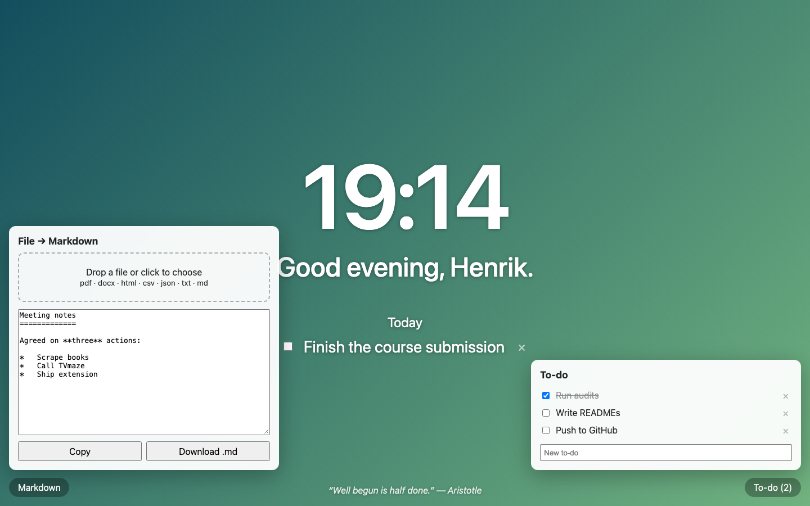

# Markdownify Tab: browser extension

A Chrome extension (Manifest V3) that replaces the new tab page with a calm personal dashboard, inspired by Momentum Dash, and adds my own productivity tool to it: a converter that turns local files into Markdown.



## Purpose

Momentum Dash turns every new tab into a short reminder of what you want to focus on. I rebuilt its core ideas in a small form and added the tool I actually use day to day. Converting PDFs, Word documents or HTML to Markdown (for notes, or to paste into an AI assistant) normally means uploading the file to a website. Here it happens locally, from any new tab.

### Momentum features I reproduced

| Momentum feature | My version |
| --- | --- |
| Large clock | `HH:MM`, updated every second |
| Personal greeting | "Good morning / afternoon / evening, *name*". Click the name to edit it |
| Daily focus ("What is your main focus for today?") | One focus per day. You can tick it off, and it resets automatically the next day |
| To-do list | Bottom-right panel. Add, tick and delete items. The button shows how many are open |
| Daily background photo | One of 7 colour gradients, changing once a day (no network request) |
| Daily quote | One of 7 quotes, changing once a day |
| **Not reproduced** | Weather, search bar, links, photo backgrounds, sync and paid features (see Limitations) |

### My addition: file → Markdown

The **Markdown** button (bottom left) opens the converter. Drop a file on it, or anywhere on the page, or click to choose one:

| Format | Library | Result |
| --- | --- | --- |
| `.pdf` | `pdfjs-dist` | Text per page, with a `# Page N` heading for each page |
| `.docx` | `mammoth` | Headings, lists, bold and italic kept |
| `.html` / `.htm` | `turndown` | ATX headings (`#`), `-` lists, fenced code |
| `.csv` | `papaparse` | Markdown table. Pipes and line breaks in cells are escaped |
| `.json` | built-in | Pretty-printed in a fenced `json` block |
| `.txt` / `.md` | built-in | Passed through unchanged |

**Copy** puts the result on the clipboard. **Download .md** saves it with the original file name (`report.pdf` → `report.md`). The same converter is also available from the toolbar popup.

## Data collection

Not applicable in the usual sense: the extension does not collect data from the web and makes **no network requests**. Its only input is what you type (name, focus, to-dos) and the files you choose to convert. Quotes and backgrounds are hard-coded in `newtab.js`.

## Data persistence

| What | Where | Why |
| --- | --- | --- |
| Your name, today's focus (with its date), the to-do list | `chrome.storage.local`, under the keys `name`, `focus` and `todos` | It survives browser restarts, is private to this extension, and needs no account or server |
| Converted files | Not stored | The Markdown exists only in the text area until you copy or download it. Files never leave your computer |

When `newtab.html` is opened outside the extension (for example during development), the same code falls back to `localStorage`.

## User interaction

1. Open a new tab: you see the clock, greeting, focus question and quote.
2. Click the name to change it, and press Enter to save.
3. Type your focus and press Enter. Tick it off when it's done, or clear it with ×.
4. **To-do** (bottom right): type and press Enter to add an item, tick to complete it, × to delete it.
5. **Markdown** (bottom left): drop or choose a file, then **Copy** or **Download .md**.
6. You can also click the extension's toolbar icon to use the converter without opening a new tab.

## Setup

Requirements: Node.js 18+ and Google Chrome (or another Chromium browser).

```bash
cd browser-extension
npm install
npm run build        # outputs the extension to dist/
```

1. Open `chrome://extensions` and turn on **Developer mode**.
2. Click **Load unpacked** and select the `browser-extension/dist` folder.
3. Open a new tab. Chrome may ask whether to keep the changed new tab page: choose **Keep it**.

`npm run dev` rebuilds on every change. Click the reload icon on `chrome://extensions` to pick up the new build. No configuration or API keys are needed.

### Project structure

| File | Role |
| --- | --- |
| `public/manifest.json` | MV3 manifest: popup, new tab override, `storage` permission |
| `newtab.html` / `.css` / `.js` | Dashboard page: clock, greeting, focus, to-dos, quote, converter panel |
| `popup.html` / `.css` / `.js` | Toolbar popup containing only the converter |
| `converters/index.js` | Picks a converter by file extension and wires up the drop zone, copy and download. Shared by the popup and the new tab page |
| `converters/*.js` | One small module per file format |
| `vite.config.mjs` | Builds both pages and bundles the libraries (MV3 forbids loading scripts from a CDN) |

## Learning

- **Manifest V3 restrictions.** MV3 extensions may not load remote code, so pdf.js cannot come from a CDN. Vite bundles the libraries and the pdf.js worker into `dist/` (see the comment in `converters/pdf.js`).
- **Sharing code between two pages.** The popup and the new tab page both need the converter. Instead of copying the logic, I moved it into `converters/index.js` as `convertFile()` and `mountConverter()`, and both pages call it with their own elements.
- **Challenge: CSV edge cases.** When I audited the project, I found that a CSV cell containing `|` broke the Markdown table, and that a trailing newline produced an empty row. I fixed both by escaping cell content and using Papa Parse's `skipEmptyLines`.
- **Challenge: "daily" features without a server.** The focus and the background must change at midnight. I store the focus together with its date (`YYYY-MM-DD` in local time) and ignore it when the date no longer matches. The background and quote are picked from the day number, so no state is needed.

## Limitations and assistance

**Limitations**
- Not a full Momentum clone: no weather, search, links, photo backgrounds, sync across devices, or settings page.
- PDF conversion extracts plain text only. Tables, columns and images are lost, and scanned PDFs (images) give no text.
- `.doc` (old Word), `.pptx` and `.xlsx` are not supported.
- The production build is large (about 2 MB) because pdf.js and its worker are bundled.
- No extension icons are included, so Chrome shows a default letter icon.
- Tested by hand in Chrome on macOS. There are no automated tests.

**Assistance**
- Libraries: [pdf.js](https://mozilla.github.io/pdf.js/), [mammoth](https://github.com/mwilliamson/mammoth.js), [turndown](https://github.com/mixmark-io/turndown), [Papa Parse](https://www.papaparse.com/), [Vite](https://vitejs.dev/).
- The dashboard's features are modelled on [Momentum Dash](https://momentumdash.com/). No Momentum code, images or text were used.
- AI: Claude Code (Anthropic) was used to build the new tab dashboard, refactor the shared converter module, fix the CSV converter, run the publication audit (see [AUDIT.md](AUDIT.md)) and draft this README.
