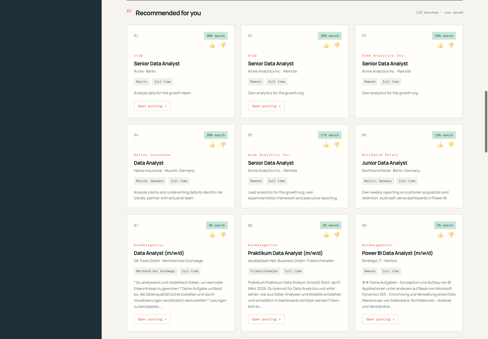

# Job Hunting Agent (extra work, not one of the three graded projects)

> **Extra work.** This project goes beyond the three required course projects. It is included because it is where I learned the most (see the root README), and it follows the same submission requirements: README, `AUDIT.md`, configuration template and screenshot.
>
> **Group work.** Built together with Luca Isaak (12 of the commits in this history are his, 3 come from the GitHub Copilot coding agent). It was developed in a separate repository and merged in here with its history.



*Screenshot: the results screen after uploading the fake test CV `backend/tests/fixtures/cvs/analytics_intern.txt` and searching for "Data Analyst". Cards show the match score, source, a like/dislike button and a link to the original posting.*

## Purpose

A web app that helps someone find jobs that fit their CV. You upload a CV (PDF, DOCX or text). The app extracts a structured profile from it (skills, work history, seniority, languages, education), searches several public job APIs live, and ranks every posting against the profile with an explainable score from 0 to 100. You can correct the extracted profile, filter by region, country, language, industry, seniority and remote type, and like or dislike jobs.

A background "health monitor" agent checks every job source on a timer. When a source breaks (for example because an API changed), it can ask Claude to diagnose the error and propose a fix to the scraper code, which a human reviews before it is applied.

## Data collection

All job data comes from public APIs, called live when you run a search (`backend/src/jobhunter/scrapers/`):

| Source | Needs a key | What it returns |
|---|---|---|
| [Arbeitnow](https://www.arbeitnow.com/api/job-board-api) | No | Jobs in Germany and remote jobs |
| [Bundesagentur für Arbeit](https://jobsuche.api.bund.dev/) | No (uses the publicly documented client id) | The German federal employment agency's job search |
| [Greenhouse](https://developers.greenhouse.io/job-board.html) and [Lever](https://github.com/lever/postings-api) company boards | No | Open roles at selected companies, picked by the industries found in the CV |
| [Adzuna](https://developer.adzuna.com/) | Yes (free) | Broad job market search, only used when `ADZUNA_APP_ID`/`ADZUNA_APP_KEY` are set |
| Jooble, EURES | Yes | Only used when endpoint and key are configured |

The candidate data comes from the CV the user uploads. Text is read with PyMuPDF (PDF), from the DOCX XML, or with Tesseract OCR for scanned PDFs. A rule-based extractor turns it into a profile. If `ANTHROPIC_API_KEY` is set, an extra Claude pass improves the extraction. Without a key, the app falls back to the rules alone.

`backend/data/seed_jobs.json` holds 31 hand-written sample postings for the offline matcher and the tests.

## Data persistence

Everything is stored in one local SQLite file, `backend/data/jobhunter.sqlite3` (path configurable with `JOBHUNTER_DB_PATH`). It is created on first start.

| What | Tables | Why |
|---|---|---|
| Uploaded CV text and the extracted profile | `profiles`, `candidates`, `candidate_profiles` | So the user can edit the profile and search again without uploading again |
| Jobs found by searches and the seed jobs, with skills and languages | `jobs`, `job_skills`, `job_languages`, `job_certifications`, `discovered_jobs` | To rank, deduplicate and show job details |
| TF-IDF statistics | `corpus_stats`, `corpus_meta` | For the semantic similarity part of the score |
| Search and match runs | `search_runs`, `match_runs` | So a past run can be reopened by its id |
| Likes and dislikes | `job_feedback` | They add a small bonus or penalty to similar jobs |
| Source health and proposed fixes | `source_health` | For the health monitor screen |

**The database contains personal data (the full CV text), so it is git-ignored and must never be committed.** An earlier version of this project did commit it. That copy was removed from every commit before the merge (see [AUDIT.md](AUDIT.md)). The demo login only stores the name and email you type in the browser's `localStorage`. It is not verified and not sent anywhere.

## User interaction

1. Open the frontend and enter a name on the demo login screen (no password is checked).
2. Upload a CV, or press **Skip — search by role instead** to search without one.
3. Review the extracted profile: fix seniority, years of experience, skills and languages, then continue.
4. Set the search: role, keywords, company, industry, remote type, employment type, seniority, regions/countries, city and languages. Press **Run search**.
5. Results come back ranked by match score, 20 per page. Each card links to the original posting. 👍/👎 saves feedback, and liked jobs appear on the profile page.
6. The **Profile** page lists which job sources work. For a broken source, you can review the proposed fix, try it, apply it or dismiss it. **API status** in the top bar checks that the backend is reachable.

The backend also has a JSON API (FastAPI docs at `http://127.0.0.1:8000/docs`), for example `POST /api/candidates/upload-file`, `POST /api/search`, `GET /api/jobs` and `GET /api/health/sources`.

## Setup

**Requirements:** Python 3.11+, Node.js 20.19+ and npm. Optional: Tesseract with English and German data for scanned PDFs (`brew install tesseract tesseract-lang` on macOS).

**1. Backend** (first terminal):

```bash
cd extra-job-hunting-agent/backend
python3 -m venv .venv
./.venv/bin/python -m pip install -e '.[dev]'
cp .env.example .env            # optional: every value can stay empty
./.venv/bin/python scripts/load_jobs.py data/seed_jobs.json   # optional: sample jobs for the matcher
./.venv/bin/uvicorn jobhunter.main:app --reload --port 8000
```

**2. Frontend** (second terminal):

```bash
cd extra-job-hunting-agent/frontend
npm install
npm run dev
```

Open http://localhost:5173. If the backend runs on another port, start Vite with `VITE_API_URL=http://127.0.0.1:<port> npm run dev`.

**Configuration:** all settings are optional and documented in [`backend/.env.example`](backend/.env.example). Without any keys, the app uses Arbeitnow, Bundesagentur and the company boards with the rule-based extractor.

**Tests:** `cd backend && ./.venv/bin/python -m pytest` (241 tests, no network or API key needed).

**Stop:** `Ctrl+C` in both terminals. If a port stays busy: `kill $(lsof -ti :8000)`.

## Learning

*(Draft based on the commit history. To be rewritten in my own words.)*

- **Working with many APIs at once.** Each job API returns a different shape (fields, pagination, location formats, auth). The `scripts/step_01_…`/`step_02_…` files and `test_greenhouse_api.py` show how I learned the Greenhouse API step by step before writing a scraper. The final design hides each source behind one scraper interface, so the rest of the app does not care where a job came from.
- **Challenge: matching a CV to a job is more than keyword search.** The first prototype used placeholder jobs and simple matching. The matching logic was reworked into a score fused from eight weighted parts (skills, experience, seniority, semantic similarity, industry, language, education, location), with reasons and gaps for every result, so a user can see why a job ranks high.
- **Challenge: personal data in Git.** The SQLite database with my own CV was committed by accident in the original repository. Adding it to `.gitignore` later did not remove it from history. When merging here, the file was removed from every commit. I learned to ignore data files from the first commit.
- **Working in a team with Git.** Luca and I worked on separate branches and merged them, which led to merge conflicts and duplicate code that had to be cleaned up.

## Limitations and assistance

**Limitations**

- The login is a demo: no accounts and no authentication. One database means one user, and the API has no authentication, so it must only run on `localhost` (the default).
- Two matching systems exist side by side (live search and the curated job database matcher). They share a database but not all logic.
- Scrapers depend on third-party APIs that can change or rate-limit without notice. The health monitor detects this, but fixes still need a human.
- The health monitor's **Try fix** runs Python code proposed by the LLM inside the backend process, and **Apply fix** overwrites a scraper file. Only use these after reading the diff. They are meant for local development.
- Scores are heuristics and were not validated against real hiring outcomes.
- `technical-description.md` holds unfinished working notes.

**Assistance**

- Built together with Luca Isaak.
- AI: the first backend MVP (core flow, API tests, CV upload) was generated by the GitHub Copilot coding agent and then extended by us. Claude Code (Anthropic) was used during development (including the health monitor) and, for this repository, to merge the project with its history, remove the CV database from history, run the publication audit ([AUDIT.md](AUDIT.md)), escape job data in the frontend, add `.env.example` and write this README.
- Libraries: FastAPI, Pydantic, Uvicorn, PyMuPDF, pytesseract, Pillow, NumPy, the Anthropic SDK, Vite.
- Data: job postings belong to the sources listed under Data collection and the employers who posted them.
