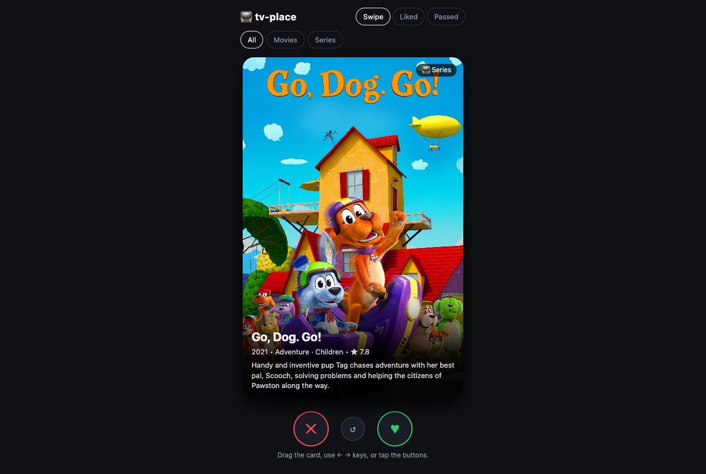

# tv-place: TVmaze API project



## Purpose

A small web app for discovering TV series. Swipe through TV series, Tinder-style. Swipe right (or press ♥) to like a show and left (or ✕) to pass. Your choices are saved in a local SQLite database and shape what you see next.

Show data comes from the free [TVmaze API](https://www.tvmaze.com/api), so no API key is needed.

## Setup

Requires Node 22.13 or newer. There is nothing to install: the project uses only Node's built-in modules (`node:http`, `node:sqlite`, `fetch`), so there are no dependencies and no API key.

```
cd tvmaze
node server.js        # or: npm start
```

Open http://localhost:3001. Optional environment variables:

| Variable | Default | Meaning |
| --- | --- | --- |
| `PORT` | `3001` | Port to listen on |
| `HOST` | `127.0.0.1` | Interface to bind. The API has no authentication, so it only listens locally by default. Use `HOST=0.0.0.0` to open it on your network, for example from a phone |

The database file `data/swipes.db` is created automatically on first run. Delete it to start over.

## User interaction

- **Swipe** tab: drag the top card right to like it or left to pass. You can also use the ← / → keys or the ✕ / ♥ buttons. ↺ undoes the last swipe.
- **Liked** / **Passed** tabs: lists of your decisions. Click a title to open it on TVmaze, or ✕ to remove the decision (the show can then appear again).
- The deck learns from your swipes: genres you like are ranked higher (see "How the recommendation works").

## Architecture

```
 Browser (public/index.html)              Node server (server.js)             External / disk
┌──────────────────────────┐   HTTP/JSON  ┌───────────────────────┐  HTTPS   ┌──────────────────┐
│ swipe UI, drag handling  │ ───────────▶ │ routing, ranking,     │ ───────▶ │ TVmaze API       │
│ keeps the deck in memory │ ◀─────────── │ validation            │ ◀─────── │ (show data)      │
└──────────────────────────┘              │          │            │          └──────────────────┘
                                          │   providers.js        │          ┌──────────────────┐
                                          │          │            │ ───────▶ │ data/swipes.db   │
                                          └──────────┴────────────┘          │ (SQLite)         │
                                                                             └──────────────────┘
```

| File | Role |
| --- | --- |
| `server.js` | HTTP server, JSON API, SQLite access, deck ranking and static file serving |
| `providers.js` | Client for the external TVmaze API. It maps TVmaze's response into the app's own title format |
| `public/index.html` | The whole frontend: HTML, CSS and JavaScript in one file |
| `data/swipes.db` | SQLite database, created on first run and git-ignored |

The browser never talks to TVmaze. It only talks to this server, and the server calls TVmaze. That keeps the data format under the app's control, so another data source could replace TVmaze by changing only `providers.js`.

## How a swipe works, step by step

1. The page loads and calls `GET /api/deck?n=8`.
2. The server loads the ids of every title you've already swiped from the database.
3. It calls TVmaze for random pages of shows and drops the ones you've seen.
4. It scores the remaining shows against your taste and returns the best 8 as JSON.
5. The browser shows them as a stack of cards. When you swipe (drag, arrow key or button), it animates the card away and sends `POST /api/swipe` with the title and your decision.
6. The server stores the title and the decision in SQLite.
7. When fewer than 5 cards are left, the browser requests another deck. Titles you just swiped are excluded because they are now in the database.

## The API of this app

All endpoints return JSON. The API is stateless and has no authentication, so there is one user per database file.

### `GET /api/deck`

Returns unseen titles, ranked for you.

| Query param | Meaning |
| --- | --- |
| `n` | Number of titles. Defaults to 10 and is capped at 30 |
| `kind` | Optional filter, `series` or `movie`. Only `series` exists with TVmaze |

```
GET /api/deck?n=2
```
```json
[
  {
    "id": "tvmaze:82",
    "source": "tvmaze",
    "kind": "series",
    "name": "Game of Thrones",
    "year": 2011,
    "genres": ["Drama", "Adventure", "Fantasy"],
    "summary": "Based on the bestselling book series ...",
    "image": "https://static.tvmaze.com/uploads/images/original_untouched/....jpg",
    "rating": 8.9,
    "url": "https://www.tvmaze.com/shows/82/game-of-thrones"
  }
]
```

The response can be shorter than `n`, or empty, if TVmaze pages returned few matching shows. The frontend retries after a short delay.

### `POST /api/swipe`

Records a decision. The request body is JSON:

```json
{ "title": { "id": "tvmaze:82", "name": "...", "genres": ["Drama"], "...": "..." }, "decision": "like" }
```

| Status | When |
| --- | --- |
| `200` `{"ok": true}` | Saved |
| `400` `{"error": "bad request"}` | `title.id` is missing, or `decision` is not `like` or `dislike` |

Swiping the same title again overwrites the earlier decision, because `title_id` is the primary key of `swipes`.

### `DELETE /api/swipe/:id`

Removes a decision, which is how undo and the ✕ button in the lists work. The id is URL-encoded, so `tvmaze:82` becomes `tvmaze%3A82`. The title then becomes eligible for the deck again. It returns `{"ok": true}` even if there was nothing to delete.

### `GET /api/likes?decision=like|dislike`

Returns saved titles, newest swipe first, each with `decision` and `created_at` added. `decision` defaults to `like`. Any value other than `dislike` is treated as `like`.

### `GET /api/stats`

```json
{ "counts": { "like": 12, "dislike": 30 }, "topGenres": ["Drama", "Crime", "Thriller"] }
```

`topGenres` holds up to the 5 genres with the highest positive score (see below). `counts` only contains decisions that exist, so it can be `{}`.

### `GET /api/config`

Returns `{"hasMovies": false}`. The frontend uses it to decide whether to show the Movies/Series filter.

### Anything else

Other paths are served from `public/` (`/` maps to `index.html`). A missing file returns `404`, and an unexpected server error returns `500` with `{"error": "..."}`.

## Data collection: the TVmaze API

[TVmaze](https://www.tvmaze.com/api) is a public, read-only REST API for TV data. It needs no key for the endpoint used here. This app makes one kind of request, in `providers.js`:

```
GET https://api.tvmaze.com/shows?page=N
```

- It returns up to **250 shows per page**, ordered by TVmaze show id. Pages start at 0. A page past the end of the list returns `404`.
- `providers.js` picks a **random page** from 0 to 279 on each call. That is how the deck gets variety without downloading the whole catalogue.
- The app uses these fields of each show: `id`, `name`, `genres`, `premiered`, `summary`, `rating.average`, `image` and `url`.

The mapping from TVmaze's response to the app's format:

| App field | TVmaze field | Notes |
| --- | --- | --- |
| `id` | `id` | Prefixed as `tvmaze:<id>`, so ids from other sources could never collide |
| `kind` | none | Always `series`, because TVmaze only has TV shows |
| `year` | `premiered` | First 4 characters of `"2011-04-17"`, or `null` |
| `summary` | `summary` | TVmaze sends HTML (`<p>`, `<b>`). A regex strips the tags |
| `image` | `image.original` | Falls back to `image.medium` |
| `rating` | `rating.average` | Score out of 10 |

**Filtering.** Shows are dropped if they have no image, no summary, or an average rating below 6.5. Cards without a poster would look broken, and the rating floor keeps the deck decent.

**Error handling.** `getJSON` aborts a request after 10 seconds and throws on any non-2xx status. `fetch()` catches that and returns an empty list, so one bad page doesn't break the deck. `buildDeck` then tries up to 4 times to fill its pool.

**Rate limit.** TVmaze documents a limit of roughly 20 requests per 10 seconds per IP address. A deck needs at most 4 requests, so normal use stays far below it.

## Data persistence: SQLite

The app stores **what you swiped and the details of those shows**, locally in `data/swipes.db` (git-ignored). SQLite needs no separate server and is built into Node, and keeping the show details means the Liked/Passed lists work without calling TVmaze again. TVmaze results that you haven't swiped are not stored.


SQLite through Node's built-in `node:sqlite` (`DatabaseSync`). It uses WAL journal mode.

```sql
CREATE TABLE titles (
  id TEXT PRIMARY KEY,         -- "tvmaze:82"
  source TEXT, kind TEXT, name TEXT, year INTEGER,
  genres TEXT,                 -- JSON array stored as text, e.g. '["Drama","Crime"]'
  summary TEXT, image TEXT, rating REAL, url TEXT
);

CREATE TABLE swipes (
  title_id TEXT PRIMARY KEY REFERENCES titles(id),
  decision TEXT NOT NULL CHECK (decision IN ('like','dislike')),
  created_at TEXT NOT NULL DEFAULT (datetime('now'))
);
```

- **Two tables.** `titles` holds show details and `swipes` holds your decisions, linked by `title_id`. A title row is written the first time you swipe it, so the lists work without calling TVmaze again.
- **`PRIMARY KEY` on `title_id`.** This allows at most one decision per title. `INSERT OR REPLACE` turns a re-swipe into an update.
- **`CHECK` constraint.** The database itself rejects any decision other than `like` or `dislike`, in addition to the server's check.
- **Prepared statements.** All queries with user input use `db.prepare(...)` and `?` placeholders instead of string concatenation, which prevents SQL injection.
- **Genres as JSON text.** Simple, but you can't query by genre in SQL. A larger app would add a `genres` table.

## How the recommendation works

`genreScores()` in `server.js` joins `swipes` with `titles` and builds a score per genre. Each like adds `+1` and each pass adds `-0.5` to every genre of that title.

`buildDeck()` then scores each candidate show:

```
score = average of its genres' scores + random number between 0 and 2
```

and returns the `n` highest-scoring shows. Example: you liked two Dramas and passed one Comedy, so Drama is `+2` and Comedy is `-0.5`. A Drama/Comedy show scores `(2 - 0.5) / 2 = 0.75` plus random noise, while a pure Drama scores `2` plus noise.

The random term keeps the deck from collapsing into a single genre. With no swipes yet, every genre scores 0 and the deck is random. Passes are weighted at half a like because disliking one show says less about a genre than loving one does.

## The frontend

`public/index.html` has no framework or build step.

- **State:** `deck` is an array of titles in memory, and `history` is the list of swipes made in this page session (used for undo).
- **Rendering:** `render()` draws the top 3 cards, and only the top card responds to input.
- **Dragging:** pointer events (`pointerdown`, `pointermove`, `pointerup`) work for both mouse and touch. The card moves and rotates with your finger. A drag of more than 100px counts as a swipe and a smaller one snaps back.
- **Undo:** it calls `DELETE /api/swipe/:id` and puts the title back on top of the deck.
- **API calls:** a small `api()` helper wraps `fetch` for every request.

## Learning

- **Separating the data source from the app.** All TVmaze-specific code lives in `providers.js`, which maps the API response into the app's own title format. The server, database and frontend never see TVmaze's format, so another source could be added in one file.
- **SQL safety and constraints.** I used prepared statements with `?` placeholders for every query that takes user input, and a `CHECK` constraint so the database itself rejects invalid decisions.
- **Challenge: a secret in Git history.** An early `test.py` for a different TV API contained a hardcoded API key. Deleting the file in a later commit was not enough, because the key stayed in the history. When this project was merged into the course repository, the file was removed from every commit, and the key has to be revoked at the provider. Now I keep keys in environment variables and check `git log` before publishing.
- **Challenge: a smooth swipe on mouse and touch.** Pointer events (`pointerdown/move/up` with `setPointerCapture`) handle both with one code path. A threshold of 100 px separates a swipe from an accidental drag.

## Limitations and assistance

**Limitations**

- There is no user system, so one database file means one person.
- The server trusts the title object sent by the browser in `POST /api/swipe`. For a multi-user app, it should store only the title id and look up the details itself.
- The server loads every swiped id on each deck request. That is fine for thousands of swipes but not for millions.
- Random pages can repeat, and the app has no server-side cache of TVmaze responses.
- TVmaze has no movies. The `kind` filter and `hasMovies` flag are there so a movie source could be added later in `providers.js`.

**Assistance**
- Data: [TVmaze API](https://www.tvmaze.com/api) (CC BY-SA). Show images and summaries belong to TVmaze and their owners.
- AI: Claude Code (Anthropic) was used to merge this project into the course repository, remove the leaked key from Git history, run the publication audit (see [AUDIT.md](AUDIT.md)), bind the server to localhost by default and add the Setup, User interaction, Learning and Assistance sections of this README.
